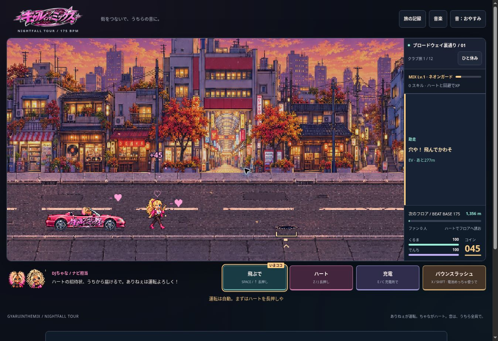

# NIGHTFALL TOUR 5.0 verification record

Recorded 20 October 2026. This document separates executed checks from prepared browser coverage and remaining release checks.

## Executed checks

- `npm test`: 504 tests passed, zero failed. Includes the existing site, checkout, audio, game and persistence regressions plus the new RPG, story, director, settings, encounter and UI suites.
- `npm run build`: passed Astro generation and public-page, canonical URL, robots, sitemap and Open Graph checks.
- `npm run lint`: passed ESLint and repository formatting checks.
- Runtime JavaScript syntax and `git diff --check`: passed.
- Existing simulation coverage includes 768 stage, route, season and weather combinations. The new RPG regression completes six twelve-road tours, reaching all six skill drafts with each starting style.
- An additional deterministic controller audit completed 120 twelve-road tours across all three styles on event and service roads: 1,440 road completions, without assists, purchases or retries. It exercised 31 rushes and optional signal repairs and bypasses. This audit preceded the final additive workshop-stacking correction; targeted tests subsequently exercised that correction. These are reachability checks, not human difficulty or enjoyment measurements.
- Overlapping shop parts and perks have actual-effect regressions: two distinct chain targets, additive charged damage, faster shield preparation, guarded penetration and bounded rush-wave range. Signal repairs preserve rewards and objectives without incrementing invited-person totals.
- Narrative tests cover six soundcheck milestones, explicit intercity transfers, remembered choices, repeat-safe callbacks and independent persistence. Director tests cover required choices, immediate journal closure, Escape propagation, key repeat and unavailable storage.

## Browser smoke test performed

Used the managed preview's standalone `/game-test/index.html` entry. Astro's development server does not serve the directory index at `/game-test/`; production route behavior remains covered by the existing container suite.

Actual UI actions exercised:

- Title, opening story, explicit narrative choice and all three style cards.
- Guardian selection, route map and departure dialogue.
- Keyboard flight, held invitations, charging, collision feedback and Guardian charge recovery.
- Roadside quiz, reward and return to the road.
- An earned level-two draft with three choices: the road remained at the same distance while reading; selecting a skill raised the displayed rank and resumed play.
- Pause, automatic invitations, damage assist and their persistence after reload.
- Reload restored the road departure checkpoint, with its style and zero in-road skills, while retaining story history.
- Journal access from the map, immediate closure, and Escape returning to a paused game without restarting the road.
- Desktop gameplay layout at an observed 1363 × 936 viewport: the full 16:9 world, health, energy, warnings and all four controls were visible together after the cockpit correction.
- The official SoundCloud widget rendered. Playback continuity was not independently established in this smoke test.

This was a focused browser smoke test, not a complete twelve-road human playthrough or a mobile performance measurement.

## Deployment baseline limitation

`npm run test:deployment` ran 154 tests with 12 failures and 10 errors in this environment. The unchanged repository HEAD was separately archived and run in the same environment: all 22 failing test IDs matched exactly. Deployment code, fixtures and safeguards are unchanged. The failures arise from deployment-owner and UID/GID assumptions in the test environment; no access control was changed to force a passing result.

## Prepared browser coverage and release gates

`tests/browser/game-test.mjs` retains the existing mobile widths, touch cancellation, map, workshop, audio, CSP and full-campaign cases. It adds story/style interactions, frozen reading time, settings persistence, journal return-to-pause, earned-skill fixtures and checkpoint rollback/commit checks. The updated suite was syntax-checked but was not executed as a complete suite in this environment.

Before merging, require the repository's browser and container CI gates, review mobile portrait/landscape captures, confirm real SoundCloud playback across scenes, and inspect frame timing on a representative phone. Follow `GAME-TEST.md` for rollout verification. This branch does not establish that the production game has changed.

The runtime manifest identifies this snapshot. `browserVerified` remains false until the full desktop/mobile browser release gate is complete; the narrower smoke-test evidence above is not treated as equivalent.
